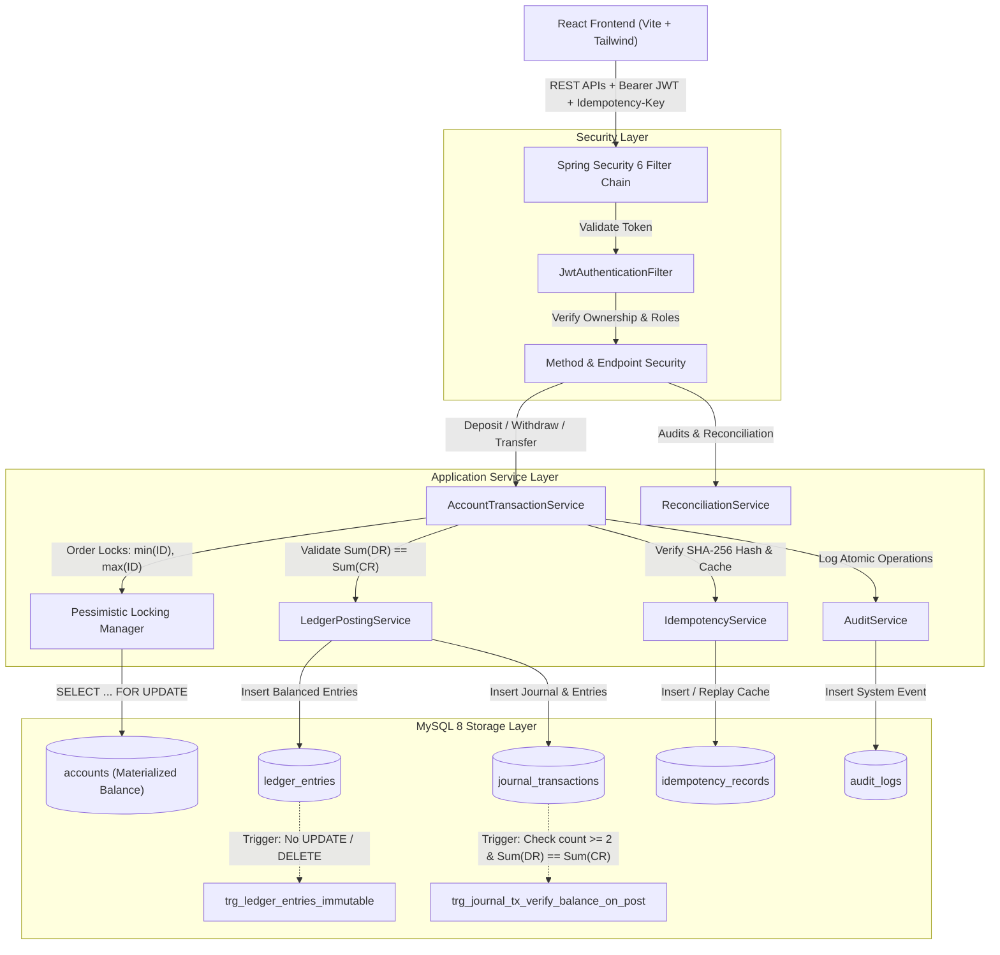

# LedgerLine: Enterprise-Grade Core Financial Ledger Platform

**Snovasys Fresher Hiring Challenge 2026**  
**Author:** Bandla Bhagya Sri  
**Repository:** [https://github.com/bhagya-sri02/LedgerLine](https://github.com/bhagya-sri02/LedgerLine)

---

## 1. Project Overview & Problem Statement

In core banking, fintech, and mission-critical financial systems, traditional single-column balance updates (`UPDATE accounts SET balance = balance + 100`) suffer from severe vulnerabilities:
- **Race conditions & phantom overdraws**: Concurrent withdrawals driving accounts negative under high traffic.
- **Deadlocks**: Bidirectional account transfers locking resources in opposite order.
- **Loss of financial traceability**: Unbalanced balance mutations without corresponding source/destination entries.
- **Audit tampering**: Modification or deletion of historical transaction entries.

**LedgerLine** solves these challenges by implementing an enterprise-grade, high-concurrency, double-entry financial ledger platform. Engineered using **Java 21 LTS**, **Spring Boot 3.3.5**, **MySQL 8.0 (InnoDB)**, and **React (Vite + Tailwind CSS)**, LedgerLine guarantees mathematical correctness, atomic double-entry balance mutations, deterministic deadlock-free concurrency, and append-only immutability.

---

## 2. Key Objectives & Design Principles

1. **Double-Entry Bookkeeping Invariant**:
   Every posted transaction inserts at least two ledger entries such that:
   $$\sum \text{Debits} = \sum \text{Credits}$$
   Customer accounts are treated as **Liabilities** from the bank's general ledger perspective (Credits increase liability/balance; Debits decrease liability/balance).
2. **Deterministic Pessimistic Concurrency**:
   Pessimistic write locks (`SELECT ... FOR UPDATE`) are acquired strictly in **ascending account-ID order** (`min(id)` then `max(id)`), eliminating circular wait conditions and preventing deadlocks during concurrent opposite transfers.
3. **Database-Level Immutability**:
   MySQL 8 triggers enforce append-only guarantees on posted ledger entries and journal transactions. Any direct SQL attempts to alter or delete posted entries are aborted with SQLSTATE `45000`.
4. **Authoritative Idempotency Engine**:
   Client requests submit an `Idempotency-Key`. The backend stores canonical SHA-256 request hashes, replaying cached receipts on duplicate submissions and rejecting altered payloads with `422 Unprocessable Entity`.
5. **Strict Role-Based Access Control (RBAC)**:
   - `ROLE_ADMIN`: Onboards users, originates bank accounts, manages account status.
   - `ROLE_ACCOUNT_HOLDER`: Transacts strictly on owned bank accounts.
   - `ROLE_AUDITOR`: Strictly read-only access to global zero-sum reconciliation, journal transactions, and audit trails.

---

## 3. Technology Stack

### Backend
- **Language**: Java 21 (LTS)
- **Framework**: Spring Boot 3.3.5
- **Security**: Spring Security 6 (Stateless JWT via JJWT 0.12.6, BCrypt cost factor 12)
- **Data & ORM**: Spring Data JPA, Hibernate 6 (`spring.jpa.hibernate.ddl-auto=validate`)
- **Database**: MySQL 8.0 (InnoDB, ACID compliant, UTF8MB4)
- **Database Migrations**: Flyway (single source of truth for schema & constraints)
- **Resilience**: Spring Retry (proxy-ordered with fresh transaction execution)
- **Testing**: JUnit 5, MockMvc, MySQL 8 Testcontainers

### Frontend
- **Framework**: React 18
- **Build Tool**: Vite 5
- **Styling**: Tailwind CSS 3 (Stripe/Fintech-inspired UI)
- **Routing**: React Router DOM v6
- **HTTP Client**: Axios (with centralized interceptors & JWT attachment)
- **Charts**: Recharts (liquidity trends & balance flow)
- **Icons**: Lucide React

---

## 4. System Architecture



---

## 5. Database Architecture & Schema

Flyway manages the authoritative database schema:

| Table Name | Description | Key Constraints |
| :--- | :--- | :--- |
| `users` | User credentials & profile | `UNIQUE(username)`, `UNIQUE(email)`, `status` |
| `roles` | System roles | `ROLE_ADMIN`, `ROLE_ACCOUNT_HOLDER`, `ROLE_AUDITOR` |
| `user_roles` | User-role join table | Compound primary key `(user_id, role_id)` |
| `accounts` | Customer liability & system clearing accounts | `UNIQUE(account_number)`, `CHECK (balance >= 0.0000)`, `currency`, `status` |
| `journal_transactions` | Master transaction records | `UNIQUE(transaction_reference)`, `transaction_type`, `status` |
| `ledger_entries` | Immutable debit/credit entry rows | `FOREIGN KEY(transaction_id)`, `FOREIGN KEY(account_id)`, `entry_direction` |
| `idempotency_records` | Authoritative idempotency key owner | `PRIMARY KEY(idempotency_key)`, `request_hash`, `cached_response` |
| `audit_logs` | Operational & security audit trail | Actor ID, Action, Entity Type, Entity ID, Metadata JSON |

### Flyway Migrations:
- **`V1__init_schema.sql`**: Table creation with indexes, foreign keys, and decimal precision (`DECIMAL(19,4)`).
- **`V2__triggers_and_immutability.sql`**: Database triggers aborting any `UPDATE` or `DELETE` on posted ledger records (`SQLSTATE 45000`) and verifying double-entry invariants upon transaction posting.
- **`V3__seed_data.sql`**: Default roles and system settlement accounts (`SYS-CASH-SETTLEMENT-USD`, `EUR`, `GBP`).

---

## 6. Project Directory Structure

```
LedgerLine/
├── backend/
│   ├── src/main/java/com/ledgerline/
│   │   ├── api/
│   │   │   ├── controller/      # Auth, Admin, Account, Transaction, Auditor
│   │   │   └── advice/          # GlobalExceptionHandler (Structured ErrorResponse)
│   │   ├── domain/
│   │   │   ├── account/         # Account entity, repository, service, DTOs
│   │   │   ├── audit/           # AuditLog entity, repository, service
│   │   │   ├── auth/            # User, Role entities, AuthService
│   │   │   ├── ledger/          # JournalTransaction, LedgerEntry, AccountTransactionService, LedgerPostingService
│   │   │   ├── reconciliation/  # ReconciliationService, audit DTOs
│   │   │   └── transaction/     # Deposit, Withdraw, Transfer requests
│   │   └── infrastructure/
│   │       ├── idempotency/     # IdempotencyService, SHA-256 request hashing
│   │       ├── init/            # DataInitializer (default demo accounts)
│   │       └── security/        # SecurityConfig, JwtTokenProvider, JwtFilter
│   ├── src/main/resources/
│   │   ├── application.yml      # Clean Spring Boot config (placeholders only)
│   │   └── db/migration/        # Flyway V1, V2, V3 migrations
│   ├── src/test/                # Integration tests (24/24 passing against MySQL 8)
│   ├── pom.xml
│   └── run-phase3-tests.ps1     # Automated MySQL 8 test runner
├── frontend/
│   ├── src/
│   │   ├── api/                 # Axios clients (auth, accounts, transactions, admin, auditor)
│   │   ├── components/
│   │   │   ├── common/          # ReceiptModal, StatCard, StatusBadge
│   │   │   └── layout/          # AppLayout, Navbar, Sidebar, ProtectedRoute
│   │   ├── context/             # AuthContext (JWT session & role helpers)
│   │   ├── pages/               # Landing, Login, Register, Dashboard, Accounts, Deposit, Withdraw, Transfer, Transactions, Admin, Auditor
│   │   ├── App.jsx
│   │   └── main.jsx
│   ├── package.json
│   ├── vite.config.js
│   └── tailwind.config.js
├── .env.example                 # Root environment template
├── PROMPTS.md                   # Chronological decision & prompt audit log
├── THREATS.md                   # STRIDE security & threat modeling report
└── README.md
```

---

## 7. REST API Documentation

### Authentication (`/api/v1/auth`)
| Method | Endpoint | Access | Description |
| :--- | :--- | :---: | :--- |
| `POST` | `/api/v1/auth/register` | Public | Registers a new account holder (creates user + auto-provisions checking account) |
| `POST` | `/api/v1/auth/login` | Public | Authenticates credentials, returns stateless JWT |
| `GET` | `/api/v1/auth/me` | Authenticated | Returns currently authenticated user profile |

### Accounts (`/api/v1/accounts`)
| Method | Endpoint | Access | Description |
| :--- | :--- | :---: | :--- |
| `GET` | `/api/v1/accounts/my` | Account Holder | Retrieves all accounts owned by the authenticated user |
| `GET` | `/api/v1/accounts/{id}` | Owner / Admin / Auditor | Retrieves account details with ownership verification |
| `GET` | `/api/v1/accounts/{id}/statement` | Owner / Admin / Auditor | Retrieves official statement with running balances |

### Financial Transactions (`/api/v1/transactions`)
| Method | Endpoint | Access | Description |
| :--- | :--- | :---: | :--- |
| `POST` | `/api/v1/transactions/deposit` | Owner / Admin | Deposits funds (Debits Clearing, Credits Customer) |
| `POST` | `/api/v1/transactions/withdraw` | Owner / Admin | Withdraws funds with overdraft prevention (Debits Customer, Credits Clearing) |
| `POST` | `/api/v1/transactions/transfer` | Owner / Admin | Inter-account atomic transfer with ascending ID locking |

*Headers*: Supports `Idempotency-Key: <UUID>` on all financial mutations.

### Administration (`/api/v1/admin`)
| Method | Endpoint | Access | Description |
| :--- | :--- | :---: | :--- |
| `GET` | `/api/v1/admin/users` | Admin | Lists all system users and assigned roles |
| `POST` | `/api/v1/admin/users` | Admin | Manually provisions a user with specific role |
| `GET` | `/api/v1/admin/accounts` | Admin | Lists all bank accounts across the platform |
| `POST` | `/api/v1/admin/accounts` | Admin | Opens a bank account for any user with initial deposit |
| `PUT` | `/api/v1/admin/accounts/{id}/status` | Admin | Updates account status (`ACTIVE`, `FROZEN`, `CLOSED`) |

### Auditor Hub (`/api/v1/auditor`)
| Method | Endpoint | Access | Description |
| :--- | :--- | :---: | :--- |
| `GET` | `/api/v1/auditor/reconciliation` | Auditor | Audits global zero-sum balance and per-account discrepancy |
| `GET` | `/api/v1/auditor/reconciliation/accounts/{id}` | Auditor | Reconciles single account against ledger entries |
| `GET` | `/api/v1/auditor/transactions` | Auditor | Lists all double-entry journal transactions |
| `GET` | `/api/v1/auditor/ledger-entries` | Auditor | Lists all immutable raw ledger debit/credit entries |
| `GET` | `/api/v1/auditor/audit-logs` | Auditor | Lists security and administrative event audit records |

---

## 8. Installation & Execution Guide

### Prerequisites
- **Java**: JDK 21+ (`JAVA_HOME` configured)
- **Node.js**: v18+ and `npm`
- **MySQL**: 8.0+ running on port 3306 (or configured in `.env`)

### Step 1: Clone & Configure Environment
```bash
git clone https://github.com/bhagya-sri02/LedgerLine.git
cd LedgerLine

# Copy backend environment template
cp .env.example .env
```

Configure your MySQL credentials in `.env`:
```properties
DB_HOST=localhost
DB_PORT=3306
DB_NAME=ledgerline
DB_USER=root
DB_PASSWORD=your_database_password_here
JWT_SECRET=your_jwt_secret_here
PORT=8080
```

Create the MySQL database:
```sql
CREATE DATABASE ledgerline CHARACTER SET utf8mb4 COLLATE utf8mb4_unicode_ci;
```

### Step 2: Build & Start Backend
```bash
cd backend

# Compile and start Spring Boot (Flyway migrations apply automatically)
# On Windows:
.\mvnw.cmd spring-boot:run

# On Linux / macOS:
./mvnw spring-boot:run
```
The backend starts on `http://localhost:8080`.

### Step 3: Build & Start Frontend
Open a new terminal window:
```bash
cd frontend

# Install dependencies (already completed)
npm install

# Start the Vite development server
npm run dev
```
The frontend starts on `http://localhost:3000`.

### Step 4: Access Application & Demo Accounts
Navigate to `http://localhost:3000`.

#### Default Seeded Demo Credentials:
| Role | Username | Password | Purpose |
| :--- | :--- | :--- | :--- |
| **Admin** | `admin` | `Admin@123456` | Manage users, originate accounts, toggle account statuses |
| **Auditor** | `auditor` | `Auditor@123456` | Strictly read-only global reconciliation and ledger inspection |
| **Account Holder** | `john_doe` | `User@123456` | Pre-seeded customer account for testing deposits, withdrawals, and transfers |

*Note: The login page includes convenient 1-click demo filler buttons.*

---

## 9. Running Automated Tests

To execute the complete Maven integration test suite against MySQL 8:
```powershell
# Windows PowerShell automated runner:
powershell -ExecutionPolicy Bypass -File backend\run-phase3-tests.ps1
```
Or run directly with Maven against your running MySQL instance:
```bash
cd backend
mvn test -Dspring.datasource.url=jdbc:mysql://localhost:3306/ledgerline -Dspring.datasource.username=root -Dspring.datasource.password=your_database_password_here
```

### Verified Test Results (31/31 Passed):
- `SchemaValidationIntegrationTest` (1 test): Validates Hibernate entity mapping against MySQL 8 (`ddl-auto=validate`).
- `FinancialTransactionIntegrationTest` (18 tests):
  1. `testSuccessfulDeposit`
  2. `testSuccessfulWithdrawal`
  3. `testInsufficientFundsWithdrawal`
  4. `testSuccessfulTransfer`
  5. `testTransferInsufficientFunds`
  6. `testTransferCurrencyMismatch`
  7. `testTransferFrozenAccount`
  8. `testDoubleEntryBalanceInvariant`
  9. `testFailedTransactionRollback`
  10. `testConcurrentWithdrawalBalanceIntegrity` (Zero negative balance guarantee)
  11. `testConcurrentOppositeTransfersDeadlockFree` (Deterministic ascending locking)
  12. `testIdempotencySuccessAndFailure` (Authoritative SHA-256 payload cache replay)
  13. `testZeroAmountTransactionRejected` (Edge Case: zero monetary value rejection)
  14. `testNegativeAmountTransactionRejected` (Edge Case: negative monetary value rejection)
  15. `testClosedAccountTransactionRejected` (Edge Case: terminal account state guard)
  16. `testHighPrecisionDecimalRounding` (Edge Case: 4-decimal precision `HALF_EVEN` arithmetic)
  17. `testExtremelyLargeAmountHandling` (Edge Case: huge number overflow protection)
  18. `testReconciliationEngineAfterMultiAccountFlow` (Edge Case: complex chained multi-account audit)
- `SecurityAndApiIntegrationTest` (12 tests):
  1. `testUserRegistrationAndLoginSuccess`
  2. `testInvalidCredentialsFails`
  3. `testMissingTokenReturns401`
  4. `testInvalidTokenReturns401`
  5. `testTamperedTokenReturns401`
  6. `testAccountHolderCannotAccessAdminEndpoints`
  7. `testAdminCannotDirectlyAccessAccountHolderEndpoints`
  8. `testUserCannotAccessOtherUsersAccounts`
  9. `testAuditorReadOnlyPermissions`
  10. `testDepositAndWithdrawalApiIdempotency`
  11. `testTransferApiWithOwnershipValidation`
  12. `testFrozenAccountViaRestApi` (Admin freezes account; subsequent transactions blocked with 422)

---

## 10. Future Enhancements

1. **Multi-Currency FX Settlement Engine**: Real-time foreign exchange conversion rates with separate gain/loss clearing accounts.
2. **Kafka Event Sourcing**: Streaming financial transactions into Kafka topics for real-time downstream fraud detection and ledger mirror replication.
3. **Hardware Security Module (HSM)**: Storing JWT private signing keys and database encryption keys in cloud HSMs (AWS CloudHSM or Google Cloud KMS).
4. **Scheduled Automated Balance Snapshots**: Periodic cron reconciliations storing daily balance closing summaries.

---

## 11. Challenge Submission Compliance

- **Challenge**: Snovasys Fresher Hiring Challenge 2026
- **Architecture**: Core Banking Double-Entry Financial Ledger
- **Status**: Complete Full-Stack Implementation Verified (Backend & Frontend)
- **Submission Date**: November 2026
